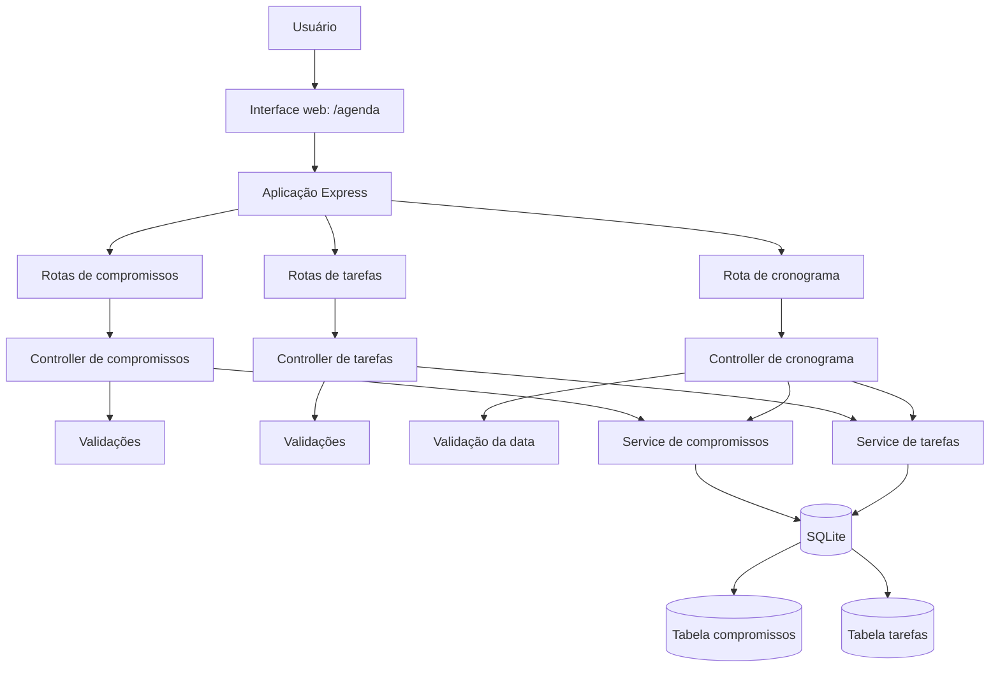

# Fluxo da aplicação

## Visão geral

A aplicação SolucaoBootcamp3 oferece uma interface web para agenda e uma API REST implementada com Express. A lógica é organizada em rotas, controllers, services, validações e persistência em SQLite.

## Inicialização

O arquivo `src/index.js` configura o Express, habilita o processamento de JSON, disponibiliza a interface estática em `/agenda` e registra as rotas da API.

A rota `/` retorna uma mensagem de confirmação do funcionamento da API.

## Recursos da API

| Recurso | Operações |
|---|---|
| `/api/compromissos` | Criar, listar, consultar por ID, atualizar e excluir |
| `/api/tarefas` | Criar, listar, consultar por ID, atualizar e excluir |
| `/api/cronograma` | Consultar compromissos e tarefas de uma data |

## Validações e respostas

Os controllers utilizam funções de `src/utils/validacoes.js` para validar os dados antes de chamar os services. As respostas incluem códigos HTTP como `201` para criação, `200` para operações bem-sucedidas, `400` para dados inválidos e `404` quando o registro solicitado não é encontrado.

## Persistência

O arquivo `src/database/database.js` utiliza `node:sqlite` e cria as tabelas `compromissos` e `tarefas` quando necessário.

- **Execução normal:** utiliza `data/agenda.db` por padrão.
- **Caminho personalizado:** pode ser definido pela variável de ambiente `DB_PATH`.
- **Testes:** utiliza banco em memória quando `NODE_ENV=test`.

Os services realizam operações SQL parametrizadas para criar, consultar, atualizar e excluir registros.

## Arquivos relacionados

- `src/index.js`: inicialização da aplicação.
- `src/routes/`: definição das rotas.
- `src/controllers/`: validação da requisição e construção das respostas HTTP.
- `src/services/`: operações de negócio e consultas SQL.
- `src/utils/validacoes.js`: funções de validação.
- `src/database/database.js`: configuração do banco e criação das tabelas.
- `public/`: arquivos estáticos da interface web.
